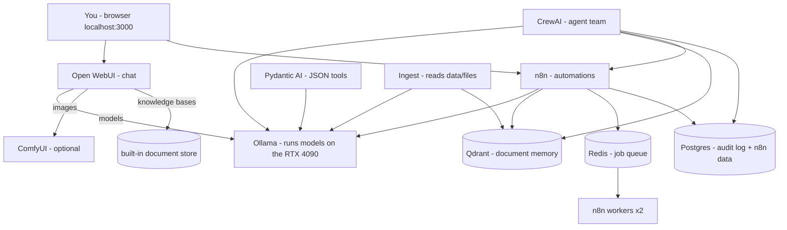

# CHAR9000 — How It Works (Architecture)

## Big picture

| Layer | Parts | Runs as |
|---|---|---|
| Chat | Open WebUI | Docker container |
| Automation | n8n main + 2 workers, Redis | Docker containers |
| Agents | CrewAI (Planner, Researcher, Build Partner, Executor), Pydantic AI | Docker containers |
| Memory | Qdrant (`my_documents`), Postgres + pgvector | Docker containers |
| Brains | Ollama + models; ComfyUI | Native Windows apps (use the GPU directly) |
| Personality | `identity/` → `CHAR9000:latest` model (qwen3.6:27b + system prompt) | built by install.ps1 |

## How a chat answer happens
1. You type a message in Open WebUI.
2. Open WebUI adds the system prompt (personality) and recent chat history, and sends it to Ollama.
3. Ollama runs qwen3.6:27b on the GPU, producing one token at a time (~35-45 tokens/second on a 4090; measure yours).
4. If you attached a knowledge base, Open WebUI first finds the most similar document chunks (embeddings) and adds them to the prompt — that's **RAG**.

## How the crew works
CrewAI runs a manager (qwen3.6:27b) that hands parts of your request to specialists: the Planner breaks
it down, the Researcher searches your documents, the Build Partner (qwen2.5-coder) writes code, and the
Executor can trigger n8n workflows — only after you approve. One big model is shared by most agents so
the GPU doesn't keep swapping models.

## Sizing for this PC

| Resource | Budget |
|---|---|
| GPU 24 GB | one ~17 GB model + small helpers; image jobs take turns with chat models |
| RAM 128 GB | Docker/WSL2 capped at 40 GB (containers ~22 GB); the rest for Windows, Ollama offload, ComfyUI, games |
| Disk | ~80 GB models (+65 GB with the big model), plus your data |

Ollama settings: 2 models max loaded, unload after 5 minutes idle, flash attention, 8-bit KV cache
(half the memory for context), 16k-token context.

## Privacy and safety design
- Every port listens on `127.0.0.1` only — nothing on your network can reach CHAR9000.
- Secrets are random values generated on your PC into `.env` (readable only by your Windows account).
- No online AI services are configured. Add one only if you decide to.
- Agency levels + an append-only, hash-chained audit log (`char9000_audit`) record every action agents take.
- n8n can only read `data\files` and `data\shared`.

## Where things live

| Path | What |
|---|---|
| `docker-compose.yml` | all containers |
| `.env` | generated settings and secrets (never shared) |
| `identity\` | personality, prompt, charter, agency level |
| `data\files` | your documents for the knowledge base |
| `data\shared` | files automations can write |
| `data\backups` | backups from `char9000.ps1 backup` |
| Docker volumes `char9000_*` | chat history, n8n, Qdrant, Postgres |
| `scripts\` | install, health check, start/stop/backup, ComfyUI helpers |

## Relationship to CAL9000
CHAR9000 is a one-PC, personal version of CAL9000 (Reworld's two-server platform). It keeps the same
building blocks and safety ideas (charter, staged autonomy, audit log), drops all work integrations,
and swaps the 67 GB llama4 model for a 27B model that fits a 4090.
